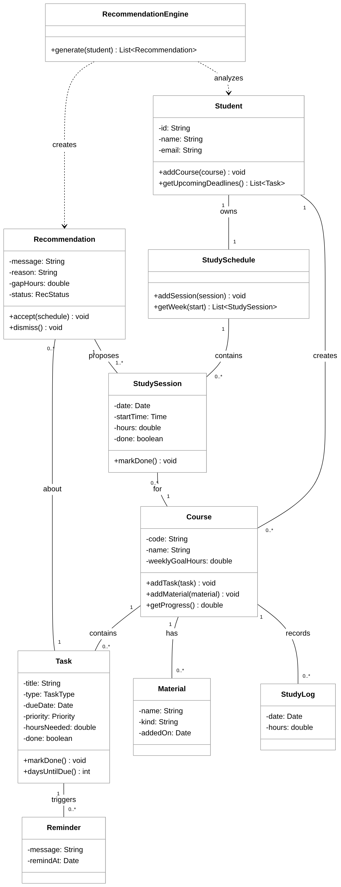

# UML Class Diagram

The diagram shows the main classes of the AI Study Assistant. A student creates courses, and each course has tasks, materials, and study logs. The student has one study schedule made of study sessions. The RecommendationEngine looks at the student's tasks and study time and creates recommendations, and each recommendation is about one task and proposes study sessions.

The Mermaid source for this diagram is in [class_diagram.mmd](class_diagram.mmd).
