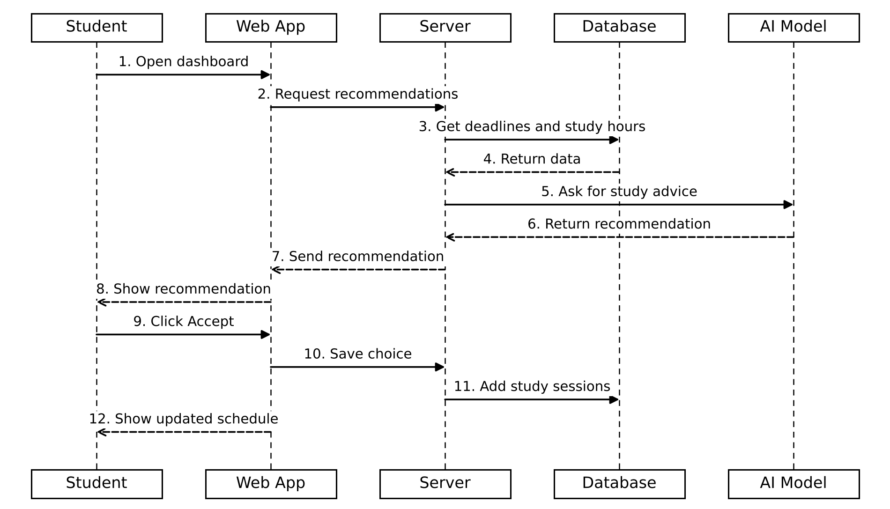

# Sequence Diagram

This sequence diagram shows what happens when a student gets a study recommendation and accepts it. When the student opens the dashboard, the server gets the student's deadlines and study hours from the database and asks the AI model what the student should study. The recommendation is shown to the student. If the student accepts it, the study sessions are added to the schedule.

The solid arrows are messages sent and the dashed arrows are replies.
