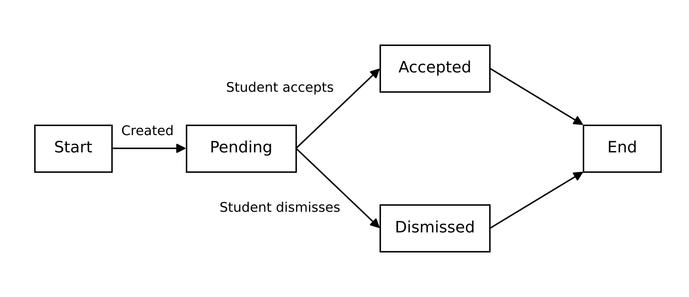

# State Machine Diagram

This state machine diagram shows the states of a recommendation. A recommendation is created when the student has a deadline coming up and has not studied enough for it. It stays in the Pending state until the student accepts it or dismisses it.

| State | Meaning |
| --- | --- |
| Pending | The recommendation is shown and waits for the student. |
| Accepted | The student accepted it and the study sessions were added to the schedule. |
| Dismissed | The student dismissed it and it is not shown anymore. |
